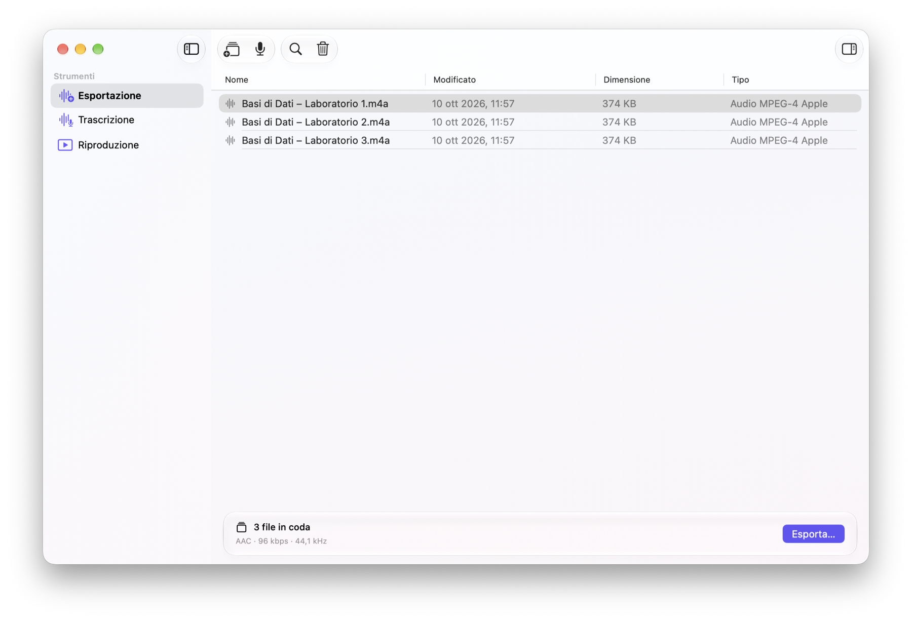
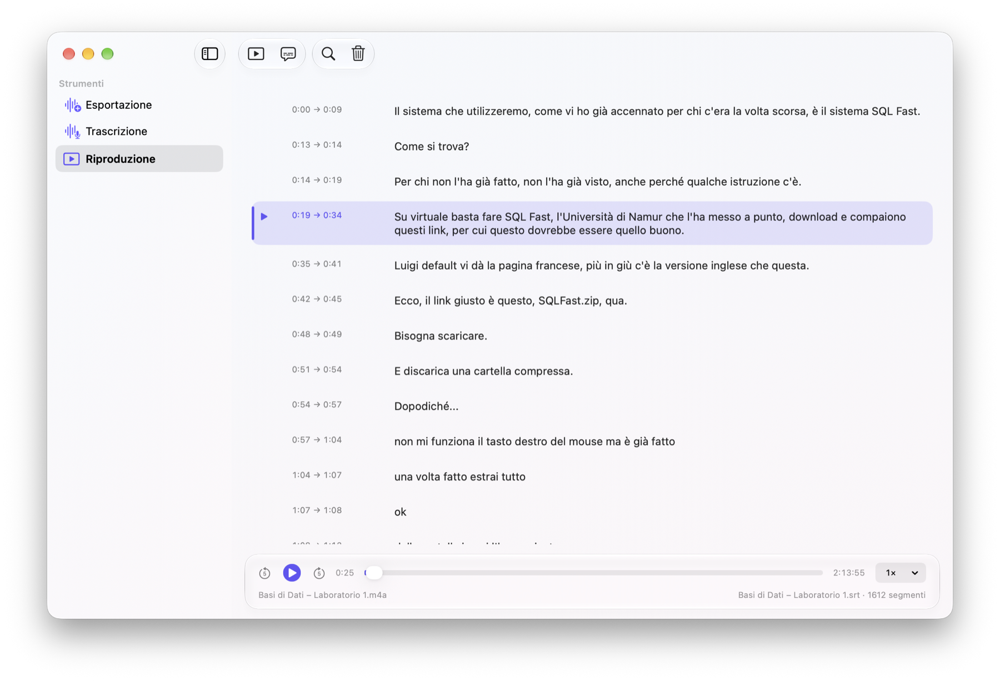

# AudioPro

**English** · [Italiano](README.it.md)

A macOS app for lecture recordings: merge and compress audio or video, transcribe on your Mac, and replay with synchronized, clickable text.

**[Download AudioPro](https://github.com/CometaSensitiva/AudioPro/releases/latest)**



## Install

Requires **macOS 26 or later**, on **Apple Silicon or Intel**.

Download `AudioPro-<version>-macOS.zip`, unzip it and move `AudioPro.app` to Applications. This version is **not notarized**: after the first opening attempt, go to **System Settings → Privacy & Security → Open Anyway**, then confirm **Open**. [Installation guide with screenshots](docs/install.md).

Whisper Large v3 is downloaded separately from **Trascrizione** on first use; it is not included in the app archive. The download needs an internet connection and several GB of disk space; transcription then runs locally.

## Use it

1. **Esportazione:** add recordings, choose audio or compressed video in the settings, then click **Esporta…**.
2. **Trascrizione:** choose a recording, download the model if requested, then save an SRT, TXT or both.
3. **Riproduzione:** open the recording and its SRT. Click a segment to jump there, search the transcript or change playback speed.



Work continues when you change sections. Existing output files stay intact until processing completes.

## Developers

Clone the repository and open `AudioPro.xcodeproj` in **Xcode 26 or later**, using the shared **AudioPro** scheme. WhisperKit is pinned to `1.0.0`; Xcode resolves it on first build. The FFmpeg helpers are included.

```sh
git clone https://github.com/CometaSensitiva/AudioPro.git
cd AudioPro
xcodebuild test -project AudioPro.xcodeproj -scheme AudioPro \
  -destination 'platform=macOS' INCLUDE_LOCAL_WHISPER_MODEL=NO \
  CODE_SIGNING_ALLOWED=NO CODE_SIGNING_REQUIRED=NO
./scripts/build-release.sh
```

The release script creates a universal ZIP and `SHA256SUMS.txt` in `dist/`. A pushed `v*` tag runs tests, builds the archive and publishes a GitHub Release; a manual workflow run only builds artifacts.

[Development and release details](docs/development.md) · [Architecture](docs/architecture.md) · [Changelog](CHANGELOG.md) · [MIT license](LICENSE). Bundled third-party tools retain their own licenses.
