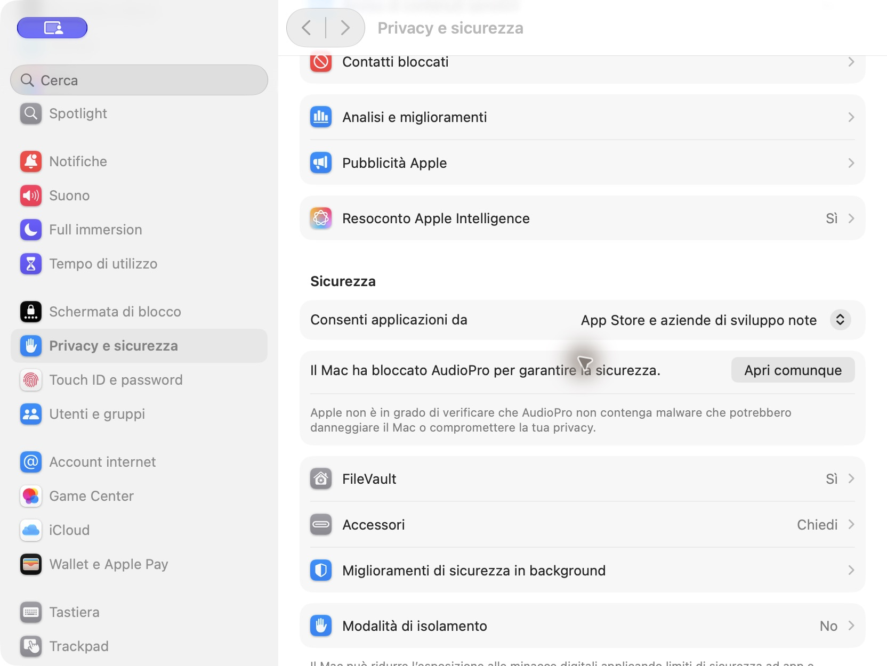

# Installare AudioPro

[English](install.md) · **Italiano**

1. Scarica `AudioPro-<version>-macOS.zip` dalle [GitHub Releases](https://github.com/CometaSensitiva/AudioPro/releases/latest).
2. Decomprimi l’archivio e sposta `AudioPro.app` in Applicazioni.
3. Apri l’app. Se macOS la blocca, chiudi l’avviso e apri **Impostazioni di Sistema → Privacy e sicurezza**.
4. Scorri fino alla sezione di sicurezza e premi **Apri comunque** accanto al messaggio di AudioPro. Autenticati se macOS lo richiede, poi conferma **Apri**.

La release attuale non è notarizzata. Questi passaggi seguono le [istruzioni Apple per il primo avvio](https://support.apple.com/it-it/102445). L’eccezione riguarda questa app; non serve un comando nel Terminale. Il pulsante compare dopo un tentativo di apertura, di solito per circa un’ora.

L’app richiede macOS 26 o successivo. Apri **Trascrizione** per scaricare Whisper Large v3 prima della prima trascrizione; le successive avvengono in locale.
